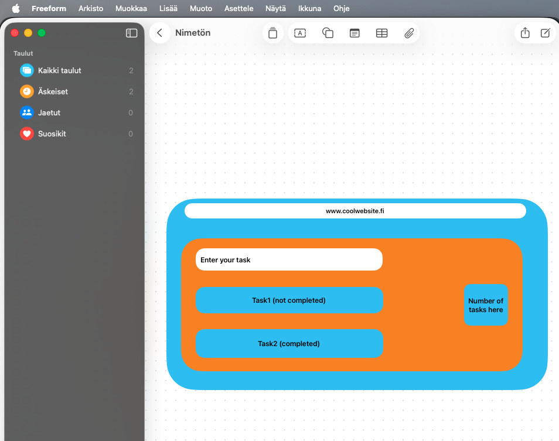
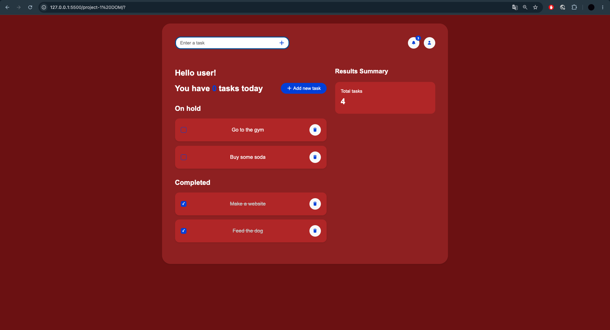

# to-do-list

**Author(s):** Samu Asplund

## Project plan

The plan is to create a simple to do list in html utilizing javascript

### Project idea

The idea is to create a to do list anyone can use to track their every day tasks. The list will be simple, but can be used for its purpose if needed.

### Planned features

List at least three features you plan to include in your application:

- Feature to add stuff to the list
- Feature once completed, the feature to change the task to completed
- Feature to remove task if necesary
- the website tracks total amount of tasks

### Wireframe / sketch

Add an image of your hand-drawn or digitally created application wireframe here. The wireframe should show the main view and the most important elements of your application.

## Web links

- **Published application:** [Add your GitHub Pages URL here](https://sacce656.github.io/project-1-DOM/)
- **GitHub repository:** [Add your repository URL here](https://github.com/SaCCe656/project-1-DOM)
- **Project video presentation:** [Add your video URL here](https://example.com/)

## About the application

**[to-do-list]** is a web application that tracks the users inputted tasks. The user can add tasks, remove them and make them completed from the interface. The application is very simple and easy to use even with little to no technical skills.

## Technologies

Describe the technologies you used and their role in your project.

- HTML – page structure
- CSS – styling and layout
- JavaScript – functionality, DOM scripting and form validation
- localStorage – saving data in the browser, if used
- Cloudfare pictures - for visual style and making picture adding easier.

## How to use the application

Write short instructions for using the application.

1. Open the published application using the link above.
2. Fill in the form fields.
3. Add, edit, remove or mark items as completed.
4. Refresh the page and check whether data remains available in the browser, if you used localStorage.

## Running the application locally

1. Clone or download this repository to your computer.
2. Open the project folder.
3. Open `index.html` in a web browser.

## Screenshots

Add at least one screenshot of your working application.

## Known issues / limitations

Bell icon and profile icon are not functional, only added for visual effect. They feature css effects etc. but dont actually do anything.

Task counter that is inside the text does not update when completing tasks.

## Self-assessment and learning reflection

Reflect on your work and learning process.

- What did I succeed in?
Planning a website having javascript in mind in the process. Learned what techniques are required to make such a list with html and javascript combined

- What was challenging?
Remembering all the techniques used previously on the course. It had been a few since I used some of the things in javascript so I had a hard time remembering.

- What would I improve if I had more time?
Starting the project earlier, it required more time than I expected. 

- What did I learn about HTML, CSS, JavaScript and DOM scripting?

I learned in action how to create and modify HTML using DOM scripting. Also reminded of previously learned things like localstorage and event listeners. I learned trough the video I watched about cloudfare pictures. It made adding small icons really easy and simple.

- What remained unclear or what would I like to learn more about?

In the start of the project I also planed to include a percent counter of how many % of tasks were completed. After starting I realized it was too hard for my skills :D

- My self-assessed project grade: **5/10 points**

## Sources and acknowledgements

List all sources, tutorials, images and code examples used in your project.

If you used ChatGPT, GitHub Copilot or another AI tool, mention it here and briefly explain how it supported your work.

- [Build a Interactive To-Do List App | HTML CSS JavaScript Mini Project 2025](https://www.youtube.com/watch?v=qsoK_6pJlu4)

- [Source code used in video:] (https://www.codynn.com/labs/create/todolist-0001)

- AI tool used: ChatGPT and VSC integrated ai tool (not sure what it uses)

  - The tools were used to help in the project in the following ways:

  Fix code in case of problems that I wasn't able to fix

  Help with writing the code, not in the sense of do this or that, but as a guide on how things work.

  Help remind of previously used techniques that I forgot on how to fully execute

  I made it step by step guide on how to approach the Javascript writing based on the html I had made. The A.I was guided not to write code itself, but to teach me how to write the feature I wanted.

## License

This project is licensed under the MIT License.

More information about adding a license to a GitHub repository:  
https://docs.github.com/en/communities/setting-up-your-project-for-healthy-contributions/adding-a-license-to-a-repository